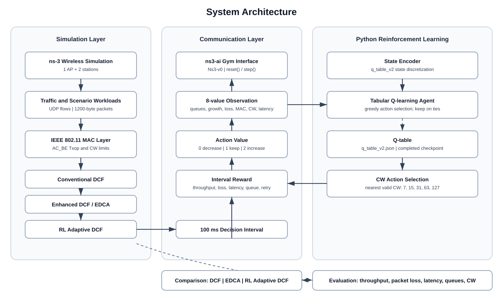

# A Reinforcement Learning-Based Approach to Optimize Network Performance in Wireless LANs

This project uses IEEE 802.11 ns-3 simulations and tabular Q-learning to investigate adaptive contention-window control in wireless LANs. It compares conventional Distributed Coordination Function (DCF), Enhanced Distributed Channel Access (EDCA), and an RL-based Adaptive DCF that selects decrease, keep, or increase actions for the MAC contention window.

## Overview

Wireless stations contend for the shared channel using a contention window (CW). Collisions, retransmissions, queue growth, and high latency can increase as offered load or traffic asymmetry changes. Conventional backoff behavior is fixed or tied to retries, so this project investigates whether a tabular Q-learning policy can select an effective AC_BE CW under changing conditions.

The ns-3 MAC remains the actual simulation implementation. A Python agent observes network state and sends a CW action through the ns3-ai Gym interface. The project compares DCF, EDCA, and RL Adaptive DCF using throughput, packet loss, end-to-end latency, queue behavior, MAC failures, and CW changes.

## Research Objectives

- Implement and evaluate conventional IEEE 802.11 DCF.
- Implement and evaluate EDCA-style QoS channel access.
- Implement RL Adaptive DCF using tabular Q-learning.
- Evaluate the methods across the repository's traffic scenarios.
- Compare them using delivered throughput, packet loss, latency, queue statistics, MAC failures, and CW adaptation.

## System Architecture



- **Simulation layer:** ns-3 creates one AP and two stations and runs DCF, EDCA, or RL Adaptive DCF.
- **IEEE 802.11 MAC:** The RL implementation controls the AC_BE minimum CW and limits for the AP and stations while keeping CWmax at 127.
- **ns3-ai Gym communication:** The C++ Gym environment exposes an eight-value observation and accepts action `0`, `1`, or `2` at 100 ms decision intervals.
- **Python RL layer:** The agent discretizes the observation, looks up `rl/q_table_v2.json`, and greedily chooses decrease, keep, or increase. Ties prefer keep; unseen states keep the current CW.
- **Evaluation layer:** Comparison scripts collect throughput, packet loss, latency, queue, and MAC statistics and produce reports.

## Methodology

### State Representation

The selected `rl/q_table_v2.json` uses the `queue-growth-loss-mac-latency-cw-v2` schema. The eight-value observation is:

1. Queue length, station A
2. Queue length, station B
3. Queue growth, station A
4. Queue growth, station B
5. Cumulative end-to-end packet-loss fraction
6. MAC failure count
7. Selected CW
8. Recent interval latency in milliseconds

The Python encoder discretizes queues, queue growth, loss, MAC failures, latency, and CW. Valid CW values are `7, 15, 31, 63, 127`.

### Actions

| Action | Meaning | CW transition |
|---:|---|---|
| 0 | Decrease | Previous valid CW; unavailable at CW 7 |
| 1 | Keep | Retain current CW |
| 2 | Increase | Next valid CW; unavailable at CW 127 |

The C++ environment updates the AP and stations' AC_BE limits and verifies the resulting values after every action.

### Reward and Learning

Every 100 ms, the C++ environment computes a bounded reward:

`0.40 * throughput - 0.20 * cumulative loss - 0.20 * latency - 0.10 * queue pressure - 0.05 * positive queue growth - 0.05 * MAC retry failure ratio`

Throughput, loss, latency, queue, growth, and retry components are normalized and clipped. End-to-end packet loss and MAC retry failures are measured separately.

Evaluation is greedy and does not retrain or modify the checkpoint. The preserved v2 checkpoint is loaded by the current scripts. Its exact historical training source and reward revision are not established from the checkpoint metadata alone; see [the final training record](rl/FINAL_TRAINING_RECORD.md).

## Technologies Used

| Technology | Project use |
|---|---|
| C++ | ns-3 simulations and Gym environment |
| Python | State encoding, Q-table policy, evaluation and comparison |
| ns-3 3.46.1 | Wireless network simulation |
| IEEE 802.11 DCF/EDCA | MAC access methods |
| ns3-ai Gym | C++/Python communication |
| Tabular Q-learning | Adaptive CW policy |
| CMake / ns3 CLI | Build and run targets |
| NumPy, Gymnasium, Protocol Buffers, psutil | Python dependencies and bindings |

## Repository Structure

```text
scratch/
  wifi-baseline.cc          Conventional DCF implementation
  wifi-edca.cc              EDCA implementation
  wifi-ai-dcf.cc            RL Adaptive DCF and Gym environment
  wifi-scenario-config.h    40 current workload definitions

rl/
  agent.py                  Q-learning entry point
  common.py                 State, action, and checkpoint helpers
  evaluate.py               Standalone greedy RL evaluation
  run_all_comparisons.py    Matched DCF/EDCA/RL runner
  compare_results.py        CSV/log comparison utility
  finalize_five_scenario_comparison.py
  q_table_v2.json           Selected completed checkpoint
  results/                  Preserved reports, CSV files, and charts
  data/                     Preserved training/evaluation artifacts
  FINAL_TRAINING_RECORD.md  Checkpoint provenance and reproduction record

docs/
  architecture.mmd          Editable Mermaid architecture source
  architecture.svg          Rendered architecture diagram
```

## Installation and Setup

### Ubuntu / WSL

The project is configured for Linux or WSL. From the ns-3 repository root:

```bash
sudo apt update
sudo apt install -y build-essential cmake ninja-build \
  libboost-all-dev libprotobuf-dev protobuf-compiler pybind11-dev

python3 -m venv .venv
.venv/bin/python -m pip install --upgrade pip
.venv/bin/python -m pip install -e contrib/ai/python_utils
.venv/bin/python -m pip install -e contrib/ai/model/gym-interface/py
```

Configure ns-3 using the same virtual environment Python:

```bash
PYTHON=$(.venv/bin/python -c 'import sys; print(sys.executable)')
./ns3 configure --enable-examples -- -DPython_EXECUTABLE="$PYTHON" \
  -DPython3_EXECUTABLE="$PYTHON"
```

The Python installs provide psutil, NumPy, Gymnasium, and Protocol Buffer bindings required by ns3-ai.

### Windows PowerShell

Run the ns-3 build and Python processes inside WSL:

```powershell
wsl
cd /mnt/c/Users/<USER>/Downloads/ns-allinone-3.46.1/ns-3.46.1
```

Do not use Windows Python for the C++/ns3-ai shared process.

## Build Instructions

Build all project targets:

```bash
./ns3 build wifi-baseline wifi-edca wifi-ai-dcf
```

Build an individual target:

```bash
./ns3 build wifi-baseline
./ns3 build wifi-edca
./ns3 build wifi-ai-dcf
```

## Running the Simulations

The project executables accept `--scenario`, `--run`, and `--seed`.

### DCF

```bash
./ns3 run "wifi-baseline --scenario=1 --run=1 --seed=12345"
```

### EDCA

```bash
./ns3 run "wifi-edca --scenario=1 --run=1 --seed=12345"
```

### RL Adaptive DCF

Set the ns3-ai Python path and run greedy Gym evaluation:

```bash
export PYTHONPATH="contrib/ai/model/gym-interface/py:contrib/ai/python_utils"
./.venv/bin/python rl/evaluate.py
```

By default this evaluates scenarios 1-40 with run 1, seed 12345, and `rl/q_table_v2.json`.

For a matched DCF/EDCA/RL comparison:

```bash
export PYTHONPATH="contrib/ai/model/gym-interface/py:contrib/ai/python_utils"
OUT_DIR="rl/results/current_comparison_$(date -u +%Y%m%dT%H%M%SZ)"
./.venv/bin/python rl/run_all_comparisons.py \
  --scenarios 1,2,3,4,5 \
  --run 1 \
  --seed 12345 \
  --checkpoint rl/q_table_v2.json \
  --output-dir "$OUT_DIR"
```

Use `--scenarios all` for current IDs 1-40. Always use a unique output directory for fresh comparisons.

## Experimental Evaluation

- **Simulation duration:** 60 seconds.
- **Measurement window:** 1-60 seconds, 59 seconds.
- **Packet payload:** 1200 bytes.
- **Network:** 1 AP and 2 stations.
- **Default run:** 1.
- **Default seed:** 12345.
- **RL decision interval:** 100 ms.
- **Scenario table:** [scratch/wifi-scenario-config.h](scratch/wifi-scenario-config.h).
- **Selected checkpoint:** [rl/q_table_v2.json](rl/q_table_v2.json).

Packet loss is `(TX - RX) / TX * 100`, where TX and RX are FlowMonitor counts at simulation stop. Packets still in flight at stop are counted as lost. Latency is accumulated end-to-end delay divided by received packets. Goodput is delivered 1200-byte application payload over 59 seconds.

## Results and Performance Analysis

### Overall Test Results (Mean Performance Values)

| Method | Mean Tx | Mean Rx | Mean Lost | Mean Loss (%) | Mean Latency (ms) | Mean Flow 1 (Mbps) | Mean Flow 2 (Mbps) | Mean Aggregate Throughput (Mbps) |
|---|---:|---:|---:|---:|---:|---:|---:|---:|
| DCF | 25001.0 | 24579.2 | 421.8 | 1.112432 | 137.266744 | 2.379563 | 1.619763 | 3.999326 |
| EDCA | 25001.0 | 24601.0 | 400.0 | 1.068273 | 137.423628 | 2.383111 | 1.619763 | 4.002874 |
| RL Adaptive DCF | 25001.0 | 24632.2 | 368.8 | 0.999875 | 107.560181 | 2.387861 | 1.620088 | 4.007949 |

All three methods transmitted the same mean number of packets. RL Adaptive DCF recorded the highest mean received packets and aggregate throughput, as well as the lowest mean packet loss and latency. These findings are limited to the five evaluated workloads and one run/seed.

## Research Contribution

The project contributes an end-to-end implementation and evaluation of tabular Q-learning for runtime adaptive contention-window control in an IEEE 802.11 ns-3 simulation. It combines real MAC observations, Gym-based Python/ns-3 communication, a discretized Q-table policy, CW verification, and matched DCF/EDCA/RL comparisons.

## Future Scope

- Repeat experiments across multiple seeds and runs with confidence intervals.
- Evaluate larger station populations and mobility/channel variation.
- Compare additional CW discretizations and reward weightings.
- Add explicit train/evaluation separation.
- Investigate per-station or per-access-category policies.
- Validate across a broader workload distribution.

These are future research extensions, not implemented functionality.

## References

- IEEE Standards Association, [IEEE 802.11 Local and Metropolitan Area Networks](https://www.ieee802.org/11/)
- ns-3 Project, [ns-3 Documentation](https://www.nsnam.org/documentation/)
- Huazhong University of Science and Technology, [ns3-ai](https://github.com/hust-diangroup/ns3-ai)
- Gymnasium, [Gymnasium documentation](https://gymnasium.farama.org/)
- Sutton and Barto, *Reinforcement Learning: An Introduction*, 2nd edition, MIT Press.
